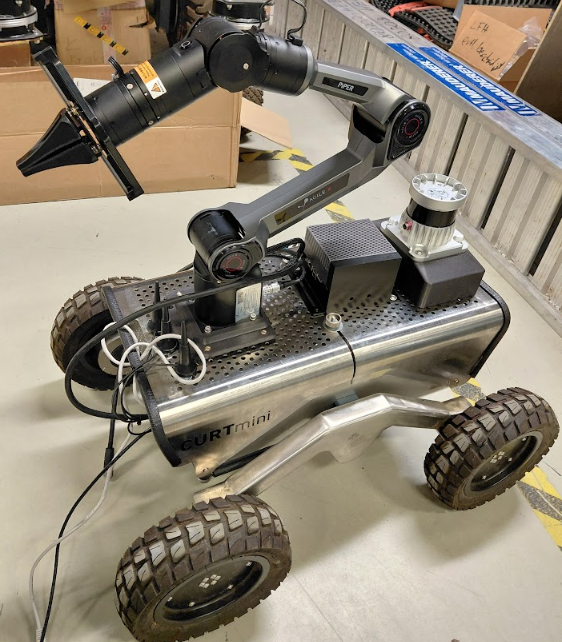

# Curt Mini with Piper Arm

<p align="center">
  
</p>

This repository contains five ROS 2 packages:

- `curtmini_piper_description`: the existing Curt Mini model combined with a
  Piper arm whose links and joints use the `piper_` prefix.
- `curtmini_piper_moveit_config`: shared SRDF, kinematics, joint limits,
  planning, perception, and RViz configuration.
- `curtmini_piper_bringup`: Piper arm control, the combined robot model,
  MoveIt runtime, and RViz. Base hardware remains in `curt_mini_bringup`.
- `curtmini_piper_navigation`: simulation mapping, localization and goal navigation. See the [navigation guide](curtmini_piper_navigation/README.md).
- `curtmini_piper_sensors`: physical RealSense camera launch and mount transforms. See the [sensor guide](curtmini_piper_sensors/README.md).

Student-facing MoveItPy, AprilTag, and Nav2 clients live in the separate
[`curtmini_piper_tools` repository](../curtmini_piper_tools/README.md).

Each package owns its Dockerfile and Compose services under `docker/`.
The root `compose.yaml` includes them; the project infrastructure remains
responsible for middleware and workspace configuration. See the
[container guide](doc/containers.md) for image dependencies, local builds,
and tests.

The prefix-aware Piper model and meshes come from `agx_arm_urdf`; the Curt Mini
model lives in `curt_mini_description`, and base controllers remain in
`curt_mini_bringup`. This package owns only the mount and TCP joints that
connect the two models.

## Workspace setup

The following instructions assume ROS 2 Jazzy and a workspace at `~/new_ws`.

Install the workspace tools and system dependencies:

```bash
source /opt/ros/jazzy/setup.bash

sudo apt update
sudo apt install -y \
  python3-colcon-common-extensions \
  python3-vcstool \
  python3-rosdep \
  python3-can \
  python3-scipy \
  can-utils \
  ethtool
```

The Python dependency installation below requires
[`uv`](https://docs.astral.sh/uv/) to be available on `PATH`.

Initialize rosdep once per machine, if it has not already been initialized:

```bash
sudo rosdep init
```

An `already initialized` message can be ignored. Update the rosdep database:

```bash
rosdep update
```

For the Piper arm and MoveIt, import the arm dependencies:
```sh
vcs import --recursive src \
  < src/curtmini_piper/docker/dependencies/arm.repos
```

To run the mobile base too, import its separate dependencies. The
`--skip-existing` option leaves the shared `curt_mini` checkout in place:

```sh
vcs import --recursive --skip-existing src \
  < src/curtmini_piper/docker/dependencies/base.repos
```

The arm manifest provides the Piper driver, model, and Curt Mini description.
The base manifest adds `candle_ros2` for the base hardware interface and
`openzen_driver` for the IMU. Both manifests use the same `curt_mini` revision.

Install the Python SDK used by the Piper hardware node:

Create a virtual environment
```sh
uv venv .venv
source .venv/bin/activate
```

Install pyAxArm python requirements
```bash
uv pip install --break-system-packages \
  "git+https://github.com/agilexrobotics/pyAgxArm.git"
```

```sh
uv pip install numpy pyyaml
```

Install the declared dependencies for the Piper arm and MoveIt:

From the workspace:
```bash
rosdep install --from-paths \
  src/piper_driver/agx_arm_ros/src \
  src/piper_driver/agx_arm_urdf \
  src/curt_mini/curt_mini_description \
  src/curtmini_piper/curtmini_piper_description \
  src/curtmini_piper/curtmini_piper_moveit_config \
  src/curtmini_piper/curtmini_piper_bringup \
  --ignore-src --rosdistro jazzy -ry
```

For the base as well, install dependencies from its packages and build
`curt_mini_bringup` with `openzen_driver`. The base driver is independent of
the Piper arm build.

## Build

From the workspace root:

```bash
source /opt/ros/jazzy/setup.bash
colcon build --packages-up-to \
  curtmini_piper_bringup
source install/setup.bash
```

If you imported the base dependencies, build them separately:

```bash
colcon build --packages-up-to curt_mini_bringup openzen_driver
source install/setup.bash
```

## Simulation

Simulation lives in the separate [curtmini_piper_gz_sim repository](https://github.com/ipa-may/curtmini_piper_gz_sim).
Clone that repository and follow its setup instructions to build and run simulation.


## Real robot

Activate the CAN bus. From the workspace:
```sh
bash src/piper_driver/agx_arm_ros/scripts/can_activate.sh
```

Start the Piper arm and MoveIt:
```bash
ros2 launch curtmini_piper_bringup bringup.launch.py
```

To start the mobile base as well, run this in a second terminal:

```bash
ros2 launch curt_mini_bringup robot_base.launch.py \
  publish_robot_description:=False
```

The Piper launch publishes the complete robot model, so the base launch skips
its own base-only model in this combination. For the base alone, use
`ros2 launch curt_mini_bringup robot_base.launch.py` with its default model
publisher. MoveIt uses prefixed names such as `piper_joint1`; a bridge
translates these to the unprefixed names expected by `agx_arm_ctrl`.

The AGX command interface defaults to `control_enabled=true` and accepts
commands continuously. Set `control_enabled:=false` to start the trajectory-status
gate, which enables commands only while a trajectory action is active.

MoveIt uses the original Curt Mini visual mesh and a simplified box collision
for the chassis. The upstream 30 MB chassis STL remains in the full
robot-state-publisher description, but is not used as an FCL collision mesh.

## Hardware-free MoveIt/RViz

For a self-contained mock arm demo, run:

```bash
ros2 launch curtmini_piper_moveit_config demo.launch.py
```

The Piper bringup also supports mock arm hardware:

```bash
ros2 launch curtmini_piper_bringup bringup.launch.py \
  start_arm_hardware:=false
```

Both the real bringup and Gazebo start `move_group` through
`curtmini_piper_moveit_config/launch/move_group.launch.py`. They select their
own MoveIt controller mapping. Start only one backend at a time.

## Standalone MoveIt RViz

Start simulation or hardware bringup with `use_rviz:=false`, then run RViz as
a separate process:

```bash
# Simulation
ros2 launch curtmini_piper_moveit_config moveit_rviz.launch.py \
  use_sim_time:=true

# Real robot
ros2 launch curtmini_piper_moveit_config moveit_rviz.launch.py \
  use_sim_time:=false
```

This launch starts only RViz and expects the active bringup to provide
`move_group`, `/joint_states`, transforms, and the planning scene. Mount and
TCP offset arguments must match those passed to the bringup launch.

## MoveItPy

Start simulation or real robot bringup first. The example package now lives in
[`curtmini_piper_tools`](../curtmini_piper_tools/curtmini_piper_moveitpy_example/README.md).
Its ROS package and `moveit_goal` command keep the same names.

## Mount calibration

The arm mount, TCP offset, and lidar mount are defined in
`curtmini_piper_description/config/geometry.yaml`. The arm and lidar mounts
are relative to `chassis`; the TCP offset is relative to `piper_link6`.
Update the YAML and restart bringup and planning clients together so their
robot descriptions use the same geometry.

## Dependency troubleshooting

The setuptools deprecation messages printed before the build starts are
warnings. The fatal error in the example above is CMake being unable to find
`candle_ros2`.

If CMake cannot find `candle_ros2`, confirm that the source import succeeded:

```bash
cd ~/piper_tests2
colcon list | grep -E '^(candle_ros2|openzen_driver)[[:space:]]'
```

Both packages should be listed. If either is missing, repeat the corresponding
`vcs import` command from the workspace setup section.

Before starting real Piper hardware, verify that its Python SDK is importable:

```bash
python3 -c "import pyAgxArm; print(pyAgxArm.__file__)"
```

The current MoveIt installation also reports a missing
`libgeometric_shapes.so.2.3.4` when loading its optional point-cloud octomap
updater. Arm planning and trajectory control still start successfully, but
depth-camera octomap updates require that system library mismatch to be fixed.
