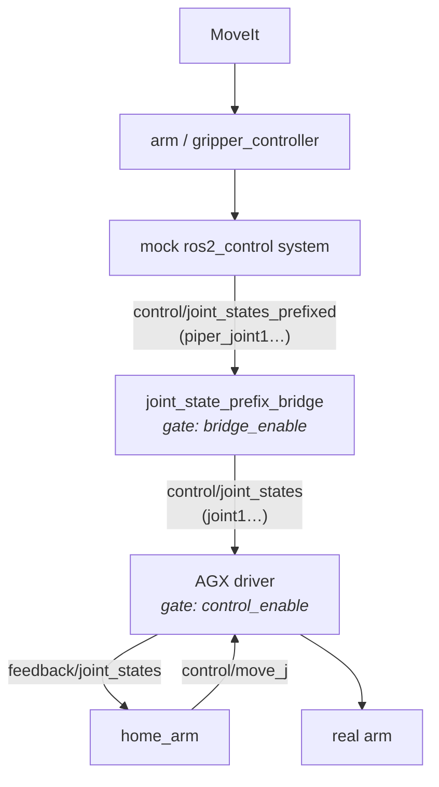

# Startup homing (`home_arm.py`)

[`scripts/home_arm.py`](scripts/home_arm.py) is the startup homing step for the Piper arm on the Curt Mini. When `start_arm_hardware:=true`, [`launch/bringup.launch.py`](launch/bringup.launch.py) runs it before anything else. MoveIt and the other "ready" actions start only after it exits, through an `OnProcessExit` handler.

It does three things:

1. Moves the real arm slowly to a known home pose, using feedback measured from the hardware.
2. Makes the mock `ros2_control` controllers agree with where the arm actually is.
3. Hands control back to the normal MoveIt → controller → hardware path without any jump.

## Data flow

There are two "gates", both `SetBool` services:

- **`bridge_enable`** (in [`scripts/joint_state_prefix_bridge.py`](scripts/joint_state_prefix_bridge.py)): when it's closed, commands from the controllers never reach the driver.
- **`control_enable`** (in the AGX driver): when it's closed, the driver sends no commands to the hardware.

During homing the bridge is closed. Only `home_arm` drives the arm, and it publishes straight to the driver's `control/move_j` topic.

## Sequence (`HomeArm.run()`)

1. **Wait until everything is up** (`startup_timeout`, 30 s by default). That means fresh hardware feedback, both gate services, both trajectory action servers, and at least one subscriber on `control/move_j`.
2. **Start watching feedback** (`monitor_feedback = True`). From now on, every wait loop and every timer tick checks that feedback is less than `feedback_timeout` (0.5 s) old. If it's older, a `HomingError` is raised.
3. **Close both gates.**
4. **Plan the move.**
   - Read the current measured pose as `start`.
   - Compute a duration so that no joint goes faster than `max_speed_deg_s` (5°/s by default). The 1.875 factor is the peak speed of the quintic blend (see [Helpers](#helpers)). The minimum duration is 1 s.
   - If the move plus `settle_time` can't fit inside `motion_timeout`, fail before moving anything.
5. **Move.** Open the driver gate and set `self.ramp`. A timer at `command_rate` (50 Hz) runs `_publish_command`, which publishes interpolated setpoints to `control/move_j`.
6. **Wait for the arm to settle.** This check runs in `_feedback_callback`, and only after the ramp has finished. The arm counts as settled when:
   - every joint is inside its URDF limits and within `position_tolerance_deg` (0.5°) of home, **and**
   - it has stayed within `settle_motion_deg` (0.1°) of an anchor pose for `settle_time` (1 s). If it drifts further, the anchor and the timer reset.
7. **Freeze.** Stop the ramp and switch to `hold`, which keeps publishing the exact measured pose so the arm stays put.
8. **Sync the controllers** (`_synchronize_controllers`).
   - Send each controller (arm, plus gripper if there is one) a single-point `FollowJointTrajectory` goal at the measured positions.
   - Because the bridge is closed, this moves only the mock system.
   - Wait until `control/joint_states_prefixed` matches the measured values to within 1e-6. Without this step, the controllers would still think the arm is at its old pose, and the arm would jump when the bridge opens.
9. **Check again.** If the real arm drifted during syncing, homing fails.
10. **Hand over control, in a safe order:**
    1. close the driver gate
    2. stop holding
    3. open the bridge
    4. set the driver gate to `release_control`

    `release_control` comes from the `control_enabled` launch argument. If it's false, the driver stays gated, and the separate `agx_arm_control_gate` node (started after homing) opens it only while a trajectory is running.

## Failure handling (`abort()` and `main()`)

Any exception, Ctrl+C or SIGTERM ends up in `abort()`, which:

- stops the ramp and hold, and cancels any controller goals;
- closes the bridge;
- publishes **one position-mode command at the current measured pose**, then closes the driver gate.

That last point matters because of a firmware issue: on Piper firmware older than 1.8-5, the driver's own emergency stop uses `move_js` (MIT mode), and switching modes can make the arm drop. For the same reason, the whole script commands the arm only through `move_j` (position mode).

`main()` sets up two things so this cleanup can still happen:

- It starts rclpy with `SignalHandlerOptions.NO`. On Ctrl+C, the ROS context then stays alive long enough for `abort()` to call services.
- It maps SIGTERM to `KeyboardInterrupt`.

The exit code is 0 on success and 1 on failure. The launch file uses that to decide whether to start MoveIt.

## Helpers

- **`joint_limits`** reads the lower and upper limits of `<prefix>joint1…6` from the URDF in `robot_description`.
- **`smooth_positions`** is a quintic blend (`10u³ − 15u⁴ + 6u⁵`). Speed and acceleration are zero at both ends, and the peak speed is 1.875× the average.
- **`_positions`** rejects malformed `JointState` messages: mismatched lengths, duplicate names, missing names, or NaN/inf values.
- **`_feedback_callback`** treats feedback as stale if its header stamp is more than `feedback_timeout` from the node's clock. It also ignores messages whose stamp isn't newer than the last one, so replayed messages can't keep the watchdog alive.

## Parameters

| Parameter | Default | Meaning |
|---|---|---|
| `robot_description` | `""` | URDF, used for the joint limits |
| `prefix` | `piper_` | Joint-name prefix used by the controllers |
| `has_gripper` | `true` | Also sync the gripper controller |
| `release_control` | `true` | Leave the driver gate open after homing |
| `home_joint_positions_deg` | `[0, 5, -5, 0, 0, 0]` | Home pose for joints 1–6 |
| `max_speed_deg_s` | `5.0` | Peak joint speed during the move |
| `position_tolerance_deg` | `0.5` | Allowed distance from home |
| `settle_motion_deg` | `0.1` | Allowed motion while settling |
| `settle_time` | `1.0` s | How long the arm must stay still |
| `startup_timeout` | `30.0` s | Wait for driver, bridge and controllers |
| `motion_timeout` | `30.0` s | Move plus settle must finish within this |
| `feedback_timeout` | `0.5` s | Maximum feedback age |
| `command_rate` | `50.0` Hz | Setpoint publish rate |

The launch file sets `prefix`, `has_gripper` and `release_control`. The rest can be overridden in the YAML passed as `homing_config`. The home pose must sit inside the joint limits with at least `position_tolerance_deg` as a margin, or the node refuses to start.

## Things worth knowing

- **Only the 6 arm joints are homed.** The gripper isn't moved. Its controller is just synced to wherever the gripper is.
- **Clock sync matters.** The staleness check compares the driver's header stamps with this node's clock. If the clocks are out of sync, or `use_sim_time` doesn't match, homing fails with "Hardware joint feedback is missing, invalid or stale".
